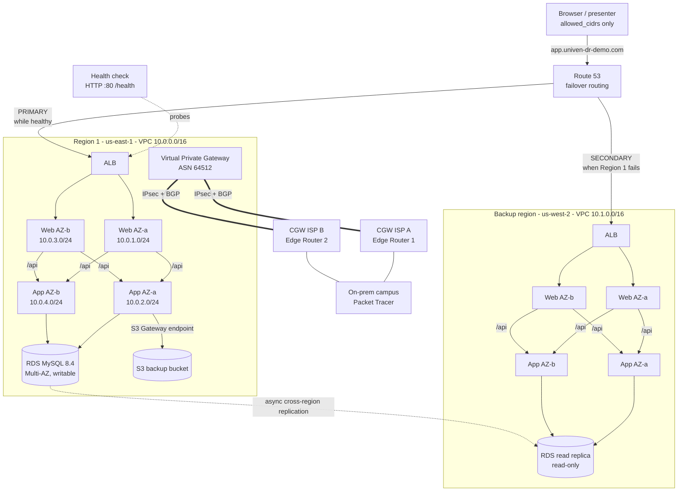
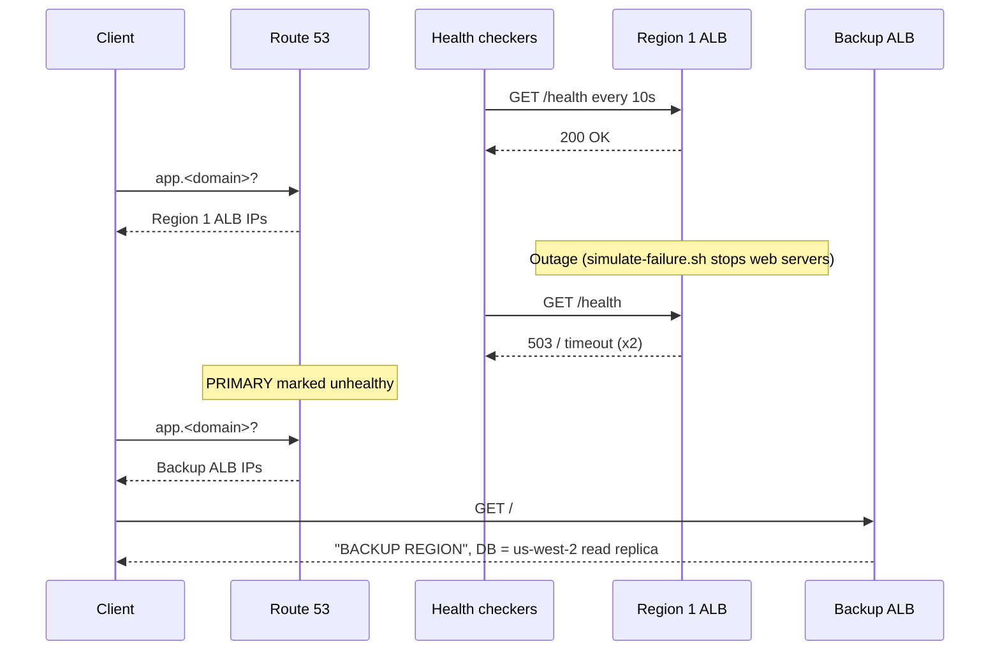

# UNIVEN Hybrid Cloud: AWS Multi-Region DR Design

This document covers the **cloud half** of the UNIVEN hybrid architecture. The
on-premises campus (core switches, HSRP/VRRP, VLANs, data centre, dual ISP edge
routers) is modelled in **Cisco Packet Tracer**. Packet Tracer cannot simulate
AWS, so the cloud is real infrastructure built with **Terraform**.

## 1. Goals

| Goal | How it is met |
|---|---|
| Survive the loss of a whole AWS region | Full stack in two regions; Route 53 failover routing |
| Automatic failover, no human in the loop | Route 53 health check on Region 1's ALB (10 s interval, 2 failures) |
| Backup region keeps serving data | Cross-region RDS read replica + per-region copy of DB credentials |
| Match the campus diagram | Same VPC/subnet layout, VGW + 2 CGWs (ISP A / ISP B) with BGP, S3 endpoint + backup bucket, IAM, CloudWatch |
| Cheapest possible one-day demo | t3.micro, db.t4g.micro, 1 NAT per region, local state, everything destroyable |
| Portable: clone and run anywhere | Only prerequisite is AWS credentials; your IP is auto-detected |

## 2. Architecture

### Request path

1. The client resolves `app.<domain>`. Route 53 answers with Region 1's ALB IPs while its health check passes.
2. The ALB forwards to a web server (Apache) in a public subnet. The web SG only accepts traffic from the ALB SG.
3. The page calls `/api/status.php`. Apache's `mod_proxy_balancer` forwards it to an app server (Apache + PHP-FPM) in a private subnet.
4. The app server connects to **the DB in its own region** over TLS (certificate verified against the RDS CA bundle), using credentials from **its own region's** Secrets Manager.
5. On Region 1 (writable DB), each request records a row in `visits`. On the backup region (replica), the same rows appear through replication. This shows the data came from Region 1.

### Failover sequence

Measured failover time is in the README (section "Test results").

## 3. Network layout

| | Region 1 (us-east-1) | Backup (us-west-2) | Diagram role |
|---|---|---|---|
| VPC | 10.0.0.0/16 | 10.1.0.0/16 | "Amazon VPC 10.0.0.0/16" |
| Public AZ-a | 10.0.1.0/24 | 10.1.1.0/24 | Bastion/Web, NAT |
| Private AZ-a | 10.0.2.0/24 | 10.1.2.0/24 | App, MySQL primary |
| Public AZ-b | 10.0.3.0/24 | 10.1.3.0/24 | Web |
| Private AZ-b | 10.0.4.0/24 | 10.1.4.0/24 | App, MySQL standby |

The VPCs do not overlap each other. Keep the on-prem VLAN ranges in Packet Tracer outside 10.0.0.0/15 so the VPN routes stay unambiguous.

## 4. Security controls

| Control | Implementation |
|---|---|
| No internet-open ports | ALB :80 only from `allowed_cidrs` (default: your public IP) + Route 53 health-checker ranges for 3 regions. A variable validation rejects `0.0.0.0/0` |
| Tiered SGs | ALB SG → Web SG → App SG → DB SG, each referencing the SG in front, never a CIDR |
| No SSH / bastion | Port 22 is never opened. Shell access via **SSM Session Manager** (replaces the diagram's bastion host) |
| Private database | `publicly_accessible = false`, private subnets, 3306 from App SG only, TLS with cert verification |
| Encryption at rest | RDS (AWS key primary, CMK for the replica), EBS root volumes, S3 SSE |
| Secrets | Password generated by `random_password`, stored in Secrets Manager in each region. Never in code. (It is in Terraform state, which is git-ignored) |
| Least-privilege IAM | Instance role: SSM core + `GetSecretValue` on this region's secret only + `s3:PutObject` to `mysql/*` **only via the S3 Gateway endpoint** |
| Instance hardening | IMDSv2 required, Apache `ServerTokens Prod`, ALB drops invalid headers |
| S3 | All 4 Block Public Access settings, ACLs disabled, TLS-only bucket policy, versioning, 7-day expiry |

### Why HTTP and not HTTPS?

ACM certificates need DNS validation on a domain you control. The default domain is a placeholder you don't own, so HTTPS can't be issued for it. If you use a real domain (`existing_hosted_zone_id`), adding an ACM cert plus an HTTPS listener is the next step. Access is restricted by source IP in the meantime.

## 5. Hybrid connectivity (VPN)

- One Virtual Private Gateway on the Region 1 VPC, route propagation on the private route table.
- Two Customer Gateways, one per ISP (matching "Customer Gateway 1 (ISP A)" / "Customer Gateway 2 (ISP B)" in the diagram), BGP ASN 65000.
- Two dynamic (BGP) VPN connections, each with 2 tunnels = 4 tunnels total.
- **The tunnels show DOWN.** The CGW IPs are documentation addresses, and Packet Tracer can't speak IPsec to AWS. Use `terraform output vpn_connections` (outside IPs, inside /30s, BGP peer IPs) and `vpn_preshared_keys` to write the matching Packet Tracer edge-router configuration.
- To bring a tunnel UP for real, put the public IP of a real router or a strongSwan VM in `customer_gateway_ips`.

## 6. Cost (one day, default settings)

Approximate, us-east-1/us-west-2 on-demand pricing:

| Item | Qty | ~ $/day |
|---|---|---|
| EC2 t3.micro | 8 | 2.00 |
| NAT Gateway | 2 | 2.16 + data |
| Site-to-site VPN connection | 2 | 2.40 |
| ALB | 2 | 1.08 + LCU |
| RDS db.t4g.micro Multi-AZ (primary) | 1 | 0.77 |
| RDS db.t4g.micro (replica) | 1 | 0.38 |
| Public IPv4 addresses | ~10 | 1.20 |
| Route 53 zone + fast health check | 1 | < 0.10 |
| Secrets Manager, KMS, S3, CloudWatch | | < 0.20 |
| **Total** | | **≈ $10–11 / day** |

Cost levers: `enable_vpn = false` (-$2.40), `db_multi_az = false` (-$0.38).

## 7. Known limitations (demo trade-offs)

- **The DB doesn't fail over automatically.** During a Region 1 outage the backup region serves read-only data from the replica. `scripts/promote-replica.sh` makes it writable (one-way).
- **Single NAT per region.** If its AZ fails, the private subnets lose outbound internet. In production you'd use one NAT per AZ.
- **Teardown-friendly settings**: `skip_final_snapshot`, no deletion protection, `force_destroy` on S3 and the hosted zone, secrets deleted without a recovery window. None of these belong in production.
- **Local state.** Use `backend.tf.example` if more than one person will run it.
